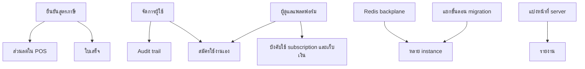

# 2. แผนแม่บทโครงการ (Project Master Plan)

## 1. วิสัยทัศน์และเป้าหมาย

**วิสัยทัศน์:** ระบบขายหน้าร้านที่ร้านค้าขนาดเล็กถึงกลางเปิดใช้ได้ทันทีผ่านเบราว์เซอร์ ขายต่อได้แม้เน็ตหลุด และเจ้าของร้านเห็นยอดขายกับสต็อกแบบทันเวลา

**เป้าหมายของแผนนี้:** พาระบบจากสถานะ "แกนหลักทำงานได้" ไปสู่ "ร้านค้าจริงใช้งานได้" แล้วจึงขยายฟีเจอร์และจำนวนร้าน

ตัวชี้วัดด้านล่างเป็นข้อเสนอ ยังไม่ได้ตกลงกับเจ้าของโครงการ และยังไม่มีค่าปัจจุบันให้เทียบ เพราะยังไม่เคยวัด:

| ด้าน | ตัวชี้วัดที่เสนอ |
| --- | --- |
| ความพร้อมใช้ | เวลาที่ระบบใช้งานได้ต่อเดือน, เวลาที่ใช้กู้ระบบจากข้อมูลสำรอง |
| การขาย | เวลาตั้งแต่สแกนสินค้าชิ้นแรกจนบันทึกบิล, สัดส่วนบิลออฟไลน์ที่ส่งสำเร็จโดยไม่ต้องมีคนจัดการ |
| คุณภาพ | จำนวนข้อบกพร่องที่พบหลัง deploy, เวลาตั้งแต่ merge จนขึ้น production |
| ธุรกิจ | จำนวนร้านที่ใช้งานจริงต่อสัปดาห์, อัตราการต่ออายุ |

## 2. สถานะปัจจุบัน

งานที่เสร็จแล้ว (รายละเอียดใน [รายงานการวิเคราะห์](01-research-report.md)):

| ระยะ | งาน | สถานะ |
| --- | --- | --- |
| 0–1 | สัญญา API, โครง frontend React | เสร็จ |
| 2–3 | Login, routing, layout, 4 หน้าจอหลัก | เสร็จ |
| 4 | Backend ตามสัญญา API | เสร็จ |
| 5 | ขายออฟไลน์, PWA | เสร็จ |
| 6 | SignalR, push notification, ส่งออก CSV | เสร็จ ยกเว้น `.xlsx` |
| 7 | ลบ Angular, ไฟล์ deploy | เสร็จ |
| – | อัปเกรด .NET 10, CI/CD | เสร็จในโค้ด ยังไม่เคยรันบน GitHub และ Portainer จริง |

## 3. หลักการของแผน

1. **ความพร้อมใช้งานจริงมาก่อนฟีเจอร์ใหม่** ระบบที่ขายได้แต่กู้ข้อมูลไม่ได้ยังเปิดให้ร้านใช้ไม่ได้
2. **ตรวจด้วยของจริงทุก milestone** แต่ละ milestone จบด้วยการรันบนสภาพแวดล้อมจริง ไม่ใช่แค่ test ผ่าน
3. **สัญญา API เปลี่ยนพร้อมโค้ดเสมอ** [docs/API_REFERENCE.md](../API_REFERENCE.md) เป็นแหล่งอ้างอิงเดียว
4. **การตัดสินใจเชิงธุรกิจเป็นของคน** AI และนักพัฒนาเสนอทางเลือกได้ แต่ไม่ตัดสินแทน

## 4. Roadmap

การประมาณแรงงานเป็น "สัปดาห์ของนักพัฒนา 1 คน" โดยสมมติว่ามี AI ช่วยเขียนโค้ดและคนตรวจ
เป็นการประมาณคร่าว ๆ จากขนาดงาน ไม่ใช่คำมั่น และควรปรับหลังจบ Milestone 1

### Milestone 1: พร้อมใช้งานจริง (ประมาณ 4–6 สัปดาห์)

เป้าหมาย: ร้านนำร่อง 1–3 ร้านใช้งานจริงได้อย่างปลอดภัย

| งาน | ผลลัพธ์ที่ต้องได้ |
| --- | --- |
| ตรวจระบบจริงครบวง | เปิดทุกหน้าจอในเบราว์เซอร์และบนแท็บเล็ต/มือถือจริง, ทดสอบออฟไลน์และ push บนอุปกรณ์จริง, แก้สิ่งที่พบ |
| เปิดใช้ CI/CD จริง | Workflow รันบน GitHub, deploy ขึ้น server จริงผ่าน Portainer พร้อม HTTPS |
| จัดการผู้ใช้ | เจ้าของร้านเพิ่ม ปิดการใช้งาน และกำหนดบทบาทผู้ใช้ได้, ผู้ใช้เปลี่ยนรหัสผ่านเองได้ |
| ป้องกันการเดารหัสผ่าน | จำกัดจำนวนครั้งที่ login ผิดต่อบัญชีและต่อ IP |
| สำรองและกู้ข้อมูล | สำรองฐานข้อมูลอัตโนมัติทุกวัน และซ้อมกู้คืนสำเร็จอย่างน้อย 1 ครั้ง |
| เฝ้าระวังระบบ | แจ้งเตือนเมื่อ `/health` ล้มเหลว, รวม log ไว้ที่เดียว |
| ความถูกต้องของสต็อก | ป้องกันการตัดสต็อกผิดเมื่อขายพร้อมกัน (optimistic concurrency) |
| ปิดการตัดสินใจที่ค้าง | สูตรภาษี, session ออฟไลน์, สต็อกติดลบของบิลออฟไลน์ |
| เอกสาร | ปรับปรุงหรือลบเอกสารเก่า 5 ไฟล์ |

**เกณฑ์ผ่าน:** ร้านนำร่องขายจริงครบ 1 สัปดาห์โดยไม่มีข้อมูลหายหรือยอดเงินผิด และกู้ระบบจากข้อมูลสำรองได้

### Milestone 2: ธุรกิจครบวงจร (ประมาณ 6–8 สัปดาห์)

เป้าหมาย: ครอบคลุมงานประจำวันของร้านโดยไม่ต้องใช้เครื่องมืออื่น

| งาน | ผลลัพธ์ที่ต้องได้ |
| --- | --- |
| ใบเสร็จ | พิมพ์และส่งออก PDF ได้จากหน้าขายและประวัติบิล |
| ประวัติบิล | หน้ารายการบิล ค้นหา ดูรายละเอียด ยกเลิก |
| ส่วนลดและโปรโมชัน | ส่วนลดรายสินค้าและท้ายบิลในหน้า POS ตามสูตรภาษีที่ยืนยันแล้ว |
| แต้มสะสมอัตโนมัติ | ได้แต้มจากการขายตามกติกาที่ร้านตั้ง |
| รายงาน | ยอดขายตามช่วงเวลา สินค้า หมวดหมู่ พนักงาน และส่งออกเป็น `.xlsx` |
| สินค้า | รูปสินค้า, นำเข้าจากไฟล์, ประวัติการปรับสต็อก |
| แบ่งหน้าที่ server | List ของสินค้า ลูกค้า และบิล |
| Audit trail | บันทึกว่าใครทำอะไรกับสต็อก บิล และผู้ใช้ |

**เกณฑ์ผ่าน:** ร้านนำร่องปิดยอดประจำวันจากระบบได้โดยไม่ต้องทำรายงานเอง

### Milestone 3: ขยายขนาดและ SaaS (ประมาณ 6–8 สัปดาห์)

เป้าหมาย: รับร้านจำนวนมากและเก็บเงินได้

| งาน | ผลลัพธ์ที่ต้องได้ |
| --- | --- |
| ผู้ดูแลแพลตฟอร์ม | ตัวตนและหน้าจอของผู้ให้บริการ แยกจากผู้ใช้ของร้าน |
| สมัครใช้งานเอง | ร้านสมัคร สร้างร้าน และผู้ใช้คนแรกได้เอง, login ด้วยชื่อร้านหรือโดเมนย่อยแทน UUID |
| บังคับใช้ subscription | จำกัดการใช้งานตามแผนและสถานะการชำระ |
| ชำระค่าบริการออนไลน์ | เชื่อมผู้ให้บริการรับชำระเงิน และออกใบแจ้งหนี้ |
| รองรับหลาย instance | Redis เป็น backplane ของ SignalR และคิวงาน, migration แยกเป็นขั้นตอนของ pipeline |
| ทดสอบภาระงาน | วัดและกำหนดขีดจำกัดต่อร้านและต่อระบบ |
| Observability | Metrics และ tracing ด้วย OpenTelemetry |

**เกณฑ์ผ่าน:** deploy โดยไม่มี downtime และระบบรับภาระตามเป้าที่ตั้งจากผลทดสอบ

### Milestone 4: เติบโต (ต่อเนื่อง)

ลำดับขึ้นกับผลสำรวจผู้ใช้ ซึ่งยังไม่ได้ทำ: หลายสาขาต่อร้าน, รับชำระเงินจากลูกค้าผ่าน QR และบัตร, เชื่อมเครื่องพิมพ์ใบเสร็จและลิ้นชักเงิน,
ฟีเจอร์ร้านอาหาร (โต๊ะ, ครัว), API สำหรับเชื่อมระบบภายนอก, การวิเคราะห์เชิงลึก

## 5. การพึ่งพาระหว่างงาน

## 6. ความเสี่ยงของแผน

| ความเสี่ยง | แนวทางลด |
| --- | --- |
| การตรวจในเบราว์เซอร์จริงพบปัญหามากกว่าที่คาด | ทำเป็นงานแรกของ M1 และกันเวลาแก้ไว้ |
| การตัดสินใจเชิงธุรกิจล่าช้า ทำให้งานที่ขึ้นกับมันค้าง | กำหนดผู้ตัดสินและวันครบกำหนดของแต่ละเรื่องตั้งแต่ต้น M1 |
| จัดลำดับฟีเจอร์ผิดเพราะไม่มีข้อมูลผู้ใช้ | เก็บความเห็นจากร้านนำร่องใน M1 ก่อนยืนยันขอบเขต M2 |
| AI สร้างโค้ดที่ผ่าน test แต่ผิดเจตนา | ใช้จุดอนุมัติของคนตาม [โครงสร้างทีม AI Agents](08-ai-agent-team.md) |
| เปลี่ยนสัญญา API แล้วอีกฝั่งไม่ตาม | แก้เอกสารสัญญา test และโค้ดสองฝั่งใน pull request เดียว |

## 7. การกำกับดูแล

- **รอบการทำงาน:** 2 สัปดาห์ จบรอบด้วยการสาธิตบนสภาพแวดล้อมจริง
- **นิยามของ "เสร็จ":** มี test, CI ผ่าน, เอกสารสัญญาและ README ที่เกี่ยวข้องอัปเดต, ตรวจในเบราว์เซอร์จริงเมื่อแตะหน้าจอ
- **การเปลี่ยนขอบเขต:** บันทึกเหตุผลและผู้อนุมัติไว้ในเอกสารนี้
- **ทบทวนแผน:** ท้ายทุก milestone
