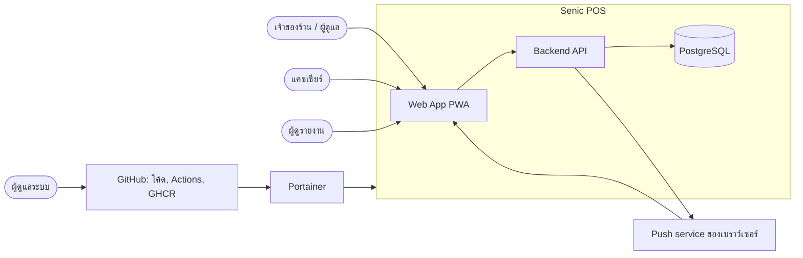
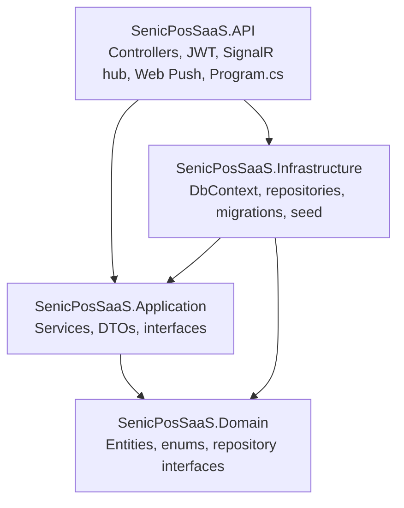
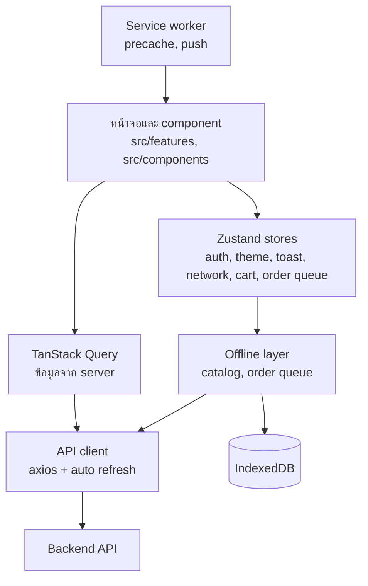
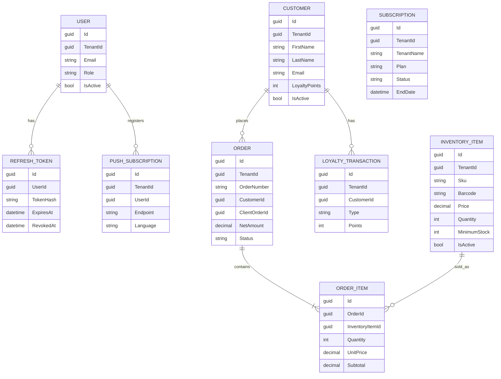
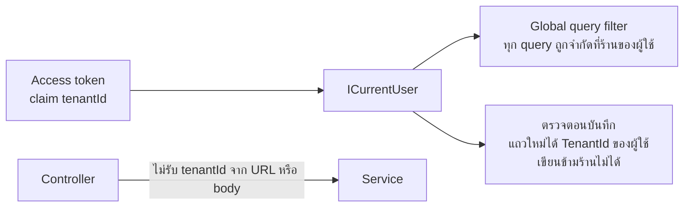
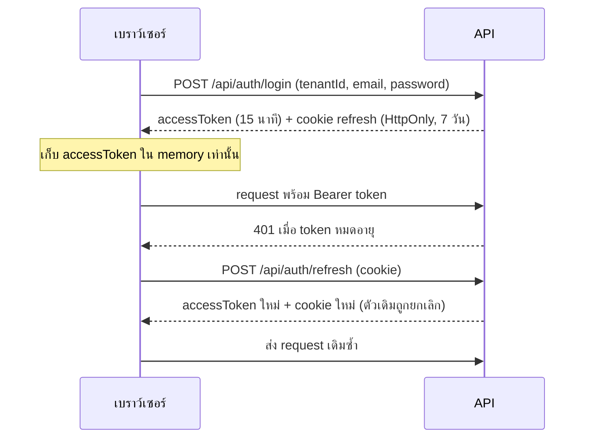
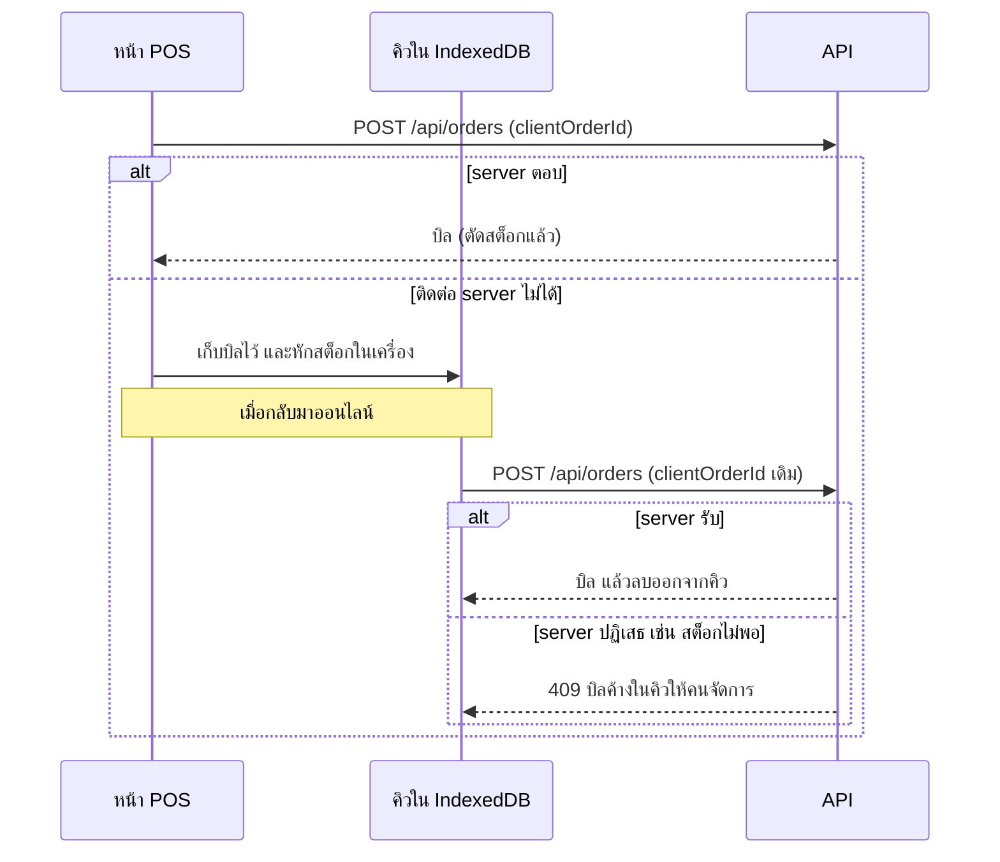
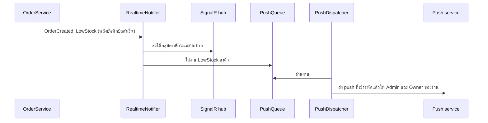
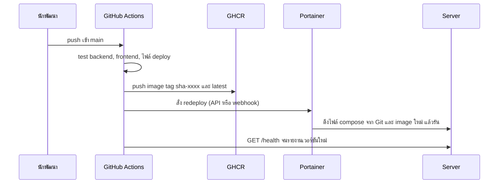
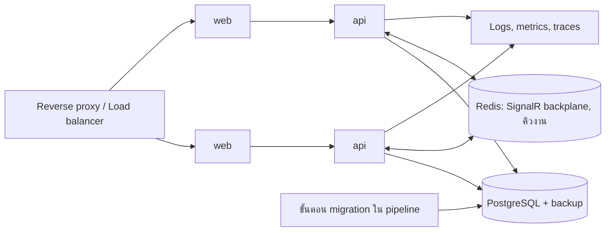

# 3. พิมพ์เขียวสถาปัตยกรรมระบบ (System Blueprint)

เอกสารนี้อธิบายโครงสร้างของระบบตามที่เป็นอยู่ในโค้ด ส่วนที่เป็นเป้าหมายในอนาคตจะระบุว่า "เป้าหมาย"

## 1. บริบทของระบบ

ระบบยังไม่เชื่อมกับระบบรับชำระเงิน เครื่องพิมพ์ หรือระบบบัญชีภายนอก

## 2. ส่วนประกอบที่รันจริง

Stack production มี 3 container ([deploy/docker-compose.yml](../../deploy/docker-compose.yml)):

| Container | Image | หน้าที่ | เปิดออกนอก |
| --- | --- | --- | --- |
| `web` | nginx + ไฟล์ของ React | เสิร์ฟแอป, ส่งต่อ `/api`, `/hubs`, `/health` ไป API | port เดียวของ stack ต้องมี HTTPS reverse proxy ด้านหน้า |
| `api` | ASP.NET Core บน .NET 10 | REST API, SignalR hub, ตัวส่ง push เบื้องหลัง | ไม่เปิด |
| `postgres` | PostgreSQL 16 | เก็บข้อมูลทั้งหมด | ไม่เปิด |

การเสิร์ฟแอปและ API จาก origin เดียวกันทำให้ไม่ต้องใช้ CORS และ cookie ของ refresh token ทำงานได้โดยไม่ต้องตั้งค่าเพิ่ม

## 3. Backend

### 3.1 ชั้นของโค้ด

- **Domain** ไม่ขึ้นกับชั้นอื่น
- **Application** รู้จักเฉพาะ interface เช่น `IOrderRepository`, `IPushSender`, `IRealtimeNotifier`
- **Infrastructure** ขึ้นกับ Application เพราะ `ApplicationDbContext` ใช้ `ICurrentUser` เพื่อกรองข้อมูลตามร้าน
- **API** เป็นที่ประกอบทุกอย่างเข้าด้วยกัน และเป็นที่อยู่ของส่วนที่ผูกกับ HTTP

### 3.2 ส่วนประกอบหลัก

| ส่วน | ที่อยู่ | หน้าที่ |
| --- | --- | --- |
| Controllers | `API/Controllers` | Auth, Inventory, Customers, Orders, Dashboard, Subscriptions, Push, Health |
| การยืนยันตัวตน | `API/Auth` | สร้าง JWT, hash รหัสผ่าน, อ่านผู้ใช้ปัจจุบันจาก token, แปลง exception เป็น ProblemDetails |
| Real-time | `API/Realtime` | `NotificationsHub` และตัวกระจาย event |
| Push | `API/Push` | ตัวส่ง Web Push, คิวใน memory, background worker |
| Services | `Application/Services` | กติกาทางธุรกิจของแต่ละโมดูล |
| Data | `Infrastructure/Data` | `ApplicationDbContext`, migration, seed, bootstrap ผู้ใช้คนแรก |

## 4. Frontend

| โฟลเดอร์ | เนื้อหา |
| --- | --- |
| `src/app` | `App`, router, `navigation.ts` (เมนูและสิทธิ์ของแต่ละหน้า), `realtime.ts` |
| `src/features/<ชื่อ>` | `auth`, `dashboard`, `pos`, `inventory`, `customers` แต่ละตัวมี pages, components, api, types |
| `src/components` | UI kit และ layout |
| `src/lib` | API client, การจัดรูปแบบ, push, ส่งออก CSV |
| `src/stores` | Zustand stores |
| `src/mocks` | API จำลองสำหรับพัฒนาและ test |
| `public/push-sw.js` | ตัวรับ push ใน service worker |

หน้าจอแต่ละหน้าโหลดแยก chunk เมื่อเปิดครั้งแรก

## 5. โมเดลข้อมูล

- "ร้าน" (tenant) ไม่มีตารางของตัวเอง เป็นเพียง `TenantId` ที่ปรากฏในข้อมูล และมีแถว `Subscription` หนึ่งแถวต่อร้าน
- ข้อมูลของร้านสืบทอดจาก `TenantEntity` ส่วน `OrderItem` และ `RefreshToken` ไม่มี `TenantId` แต่ถูกกรองตามแม่ของมัน
- รายละเอียดคอลัมน์และ index อยู่ใน [ข้อกำหนดทางเทคนิค](04-technical-design-and-specifications.md)

## 6. การแยกข้อมูลตามร้าน

มี 3 ชั้นที่ทำงานซ้อนกัน:

1. Controller อ่านรหัสร้านจาก token เท่านั้น (`TenantControllerBase`)
2. `ApplicationDbContext` ใส่ query filter ให้ทุก entity ของร้าน การขอข้อมูลด้วย id ของร้านอื่นจึงได้ "ไม่พบ"
3. ตอนบันทึก ระบบปฏิเสธการเขียนแถวที่ `TenantId` ไม่ตรงกับผู้ใช้

เมื่อไม่มีผู้ใช้ในบริบท (ตอน start, ตอน login, งานเบื้องหลัง) ตัวกรองจะไม่ทำงาน โค้ดส่วนนั้นจึงต้องกรองร้านเองอย่างชัดเจน

## 7. ลำดับการทำงานที่สำคัญ

### 7.1 Login และการต่ออายุ session

### 7.2 การขาย: ออนไลน์และออฟไลน์

`clientOrderId` ทำให้การส่งซ้ำไม่สร้างบิลใหม่และไม่ตัดสต็อกซ้ำ

### 7.3 การแจ้งเตือน

ถ้าการแจ้งเตือนล้มเหลว การขายยังสำเร็จตามปกติ

### 7.4 การ deploy

## 8. สถาปัตยกรรมด้านความปลอดภัย

| เรื่อง | การออกแบบ |
| --- | --- |
| รหัสผ่าน | Hash ด้วยตัว hash ของ ASP.NET Core Identity (PBKDF2 พร้อม salt) |
| Access token | JWT อายุ 15 นาที มี claim ผู้ใช้ ร้าน และบทบาท เก็บใน memory ของเบราว์เซอร์ |
| Refresh token | สุ่ม 32 byte, เก็บเฉพาะ hash ในฐานข้อมูล, ใช้ได้ครั้งเดียว, ส่งผ่าน cookie `HttpOnly; Secure; SameSite=Strict; Path=/api/auth` |
| สิทธิ์ | ทุก endpoint ต้อง login ยกเว้น login, refresh, logout, health และกำหนดบทบาทต่อ endpoint |
| การแยกร้าน | ตามหัวข้อ 6 |
| Push | Endpoint ต้องเป็น `https` ของ push service ที่อนุญาต เพื่อกันการใช้ server ยิงไปที่อื่น |
| ความลับ | ไม่อยู่ใน repo, production อ่านจากตัวแปรของ stack, API ไม่ start ถ้าไม่มี `Jwt:Key` |
| CORS | อนุญาตเฉพาะ origin ที่ตั้งค่า |

ช่องว่างที่ทราบ: ไม่มีการจำกัดจำนวนครั้งที่ login ผิด, ไม่มี audit trail, endpoint ข้ามร้านของ Subscription ใช้สิทธิ์ Admin ของร้าน

## 9. ข้อจำกัดของสถาปัตยกรรมปัจจุบัน

- **API รันได้ instance เดียว:** คิว push และกลุ่มของ SignalR อยู่ใน memory และ API migrate ฐานข้อมูลเองตอน start
- **ไม่มีการล็อกสต็อก:** การขายพร้อมกันอาจทำให้จำนวนคงเหลือคลาดเคลื่อน
- **รายงานคำนวณใน memory:** dashboard ดึงบิลของช่วงเวลาทั้งหมดมารวม เหมาะกับปริมาณระดับร้านเดียวในช่วงไม่เกินหนึ่งปี

## 10. สถาปัตยกรรมเป้าหมาย

เป้าหมายสำหรับ Milestone 3 ใน [แผนแม่บท](02-master-plan.md) ยังไม่ได้สร้าง:

สิ่งที่เปลี่ยนจากปัจจุบัน: migration ย้ายออกจากการ start ของ API, คิวและ SignalR ใช้ Redis, มีการสำรองข้อมูลและ observability
