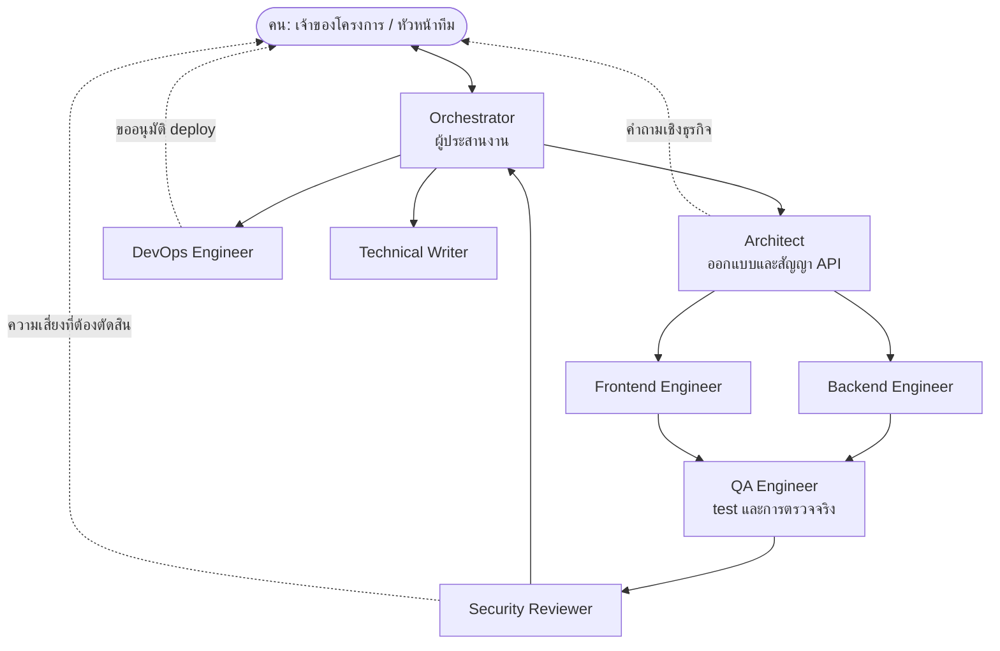
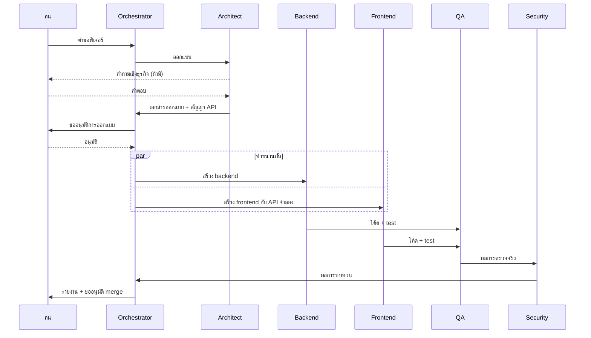

# 8. โครงสร้างทีมงาน AI Agents

เอกสารนี้เสนอการแบ่งบทบาทของ AI agent สำหรับพัฒนาโครงการนี้ และจุดที่คนต้องตัดสินใจ
เป็น **ข้อเสนอ** ที่ยังไม่ได้ตั้งค่าใช้งานจริงใน repo ควรเริ่มจากชุดเล็กในหัวข้อ 7 แล้วขยายเมื่อเห็นผล

## 1. หลักการ

1. **คนเป็นเจ้าของการตัดสินใจ** เรื่องธุรกิจ เงิน สิทธิ์ ข้อมูลของลูกค้า และการ deploy ต้องมีคนอนุมัติ
2. **แบ่ง agent เมื่อการแบ่งให้ประโยชน์จริง** คือเมื่องานทำขนานกันได้ หรือเมื่อต้องการมุมมองที่ไม่ถูกชี้นำจากคนเขียน (เช่น การทบทวน) งานเล็กให้ agent เดียวทำจนจบ
3. **ส่งต่องานด้วยเอกสารที่ตรวจได้** ไม่ใช่ด้วยการเล่าต่อ: สัญญา API, รายการไฟล์, ผล test
4. **ผู้ตรวจไม่ใช่ผู้เขียน** agent ที่ทบทวนต้องได้โค้ด ไม่ใช่ข้อสรุปของคนเขียน
5. **ทุก agent รายงานสิ่งที่ยังไม่ได้ตรวจ** ไม่อ้างว่าเสร็จถ้าไม่ได้พิสูจน์

## 2. โครงสร้างทีม



## 3. บทบาท

### Orchestrator (ผู้ประสานงาน)

| | |
| --- | --- |
| หน้าที่ | รับคำขอจากคน แตกเป็นงาน มอบหมาย รวมผล และรายงานกลับ |
| รับเข้า | คำขอของคน, [แผนแม่บท](02-master-plan.md), สถานะของ repo |
| ส่งออก | แผนงานที่ระบุลำดับและผู้รับผิดชอบ, รายงานสรุปที่แยกสิ่งที่ยืนยันแล้วกับยังไม่ยืนยัน |
| สิทธิ์ | อ่าน repo, มอบงานให้ agent อื่น ไม่แก้โค้ดเองในงานที่มอบไปแล้ว |
| ต้องถามคนเมื่อ | ขอบเขตไม่ชัด, มีทางเลือกที่กระทบธุรกิจ, งานเกินขอบเขตที่ขอ |

### Architect (ผู้ออกแบบ)

| | |
| --- | --- |
| หน้าที่ | ออกแบบฟีเจอร์ก่อนเขียนโค้ด และเป็นเจ้าของสัญญา API |
| รับเข้า | ปัญหาและผลลัพธ์ที่ต้องการ, [พิมพ์เขียว](03-system-blueprint.md), [ข้อกำหนดทางเทคนิค](04-technical-design-and-specifications.md) |
| ส่งออก | เอกสารออกแบบตาม template ข้อ 2 ใน [Prompt Template](07-ai-prompt-templates.md), ส่วนที่เพิ่มใน `docs/API_REFERENCE.md`, รายการคำถามถึงคน |
| สิทธิ์ | อ่าน repo, แก้เอกสารใน `docs/` ไม่แก้โค้ด |
| เสร็จเมื่อ | Backend และ frontend เริ่มงานขนานกันได้โดยไม่ต้องถามกันเอง |

### Backend Engineer

| | |
| --- | --- |
| หน้าที่ | สร้างและแก้โค้ดใน `backend/` ตามสัญญา |
| รับเข้า | สัญญา API และกติกาทางธุรกิจจาก Architect |
| ส่งออก | โค้ด, migration, integration test, ผล `dotnet test` |
| สิทธิ์ | แก้ไฟล์ใน `backend/`, รันคำสั่ง build และ test ในเครื่อง |
| ข้อห้าม | รับรหัสร้านจาก client, เปลี่ยนสัญญาเองโดยไม่แจ้ง Architect |
| เสร็จเมื่อ | Test ครอบคลุมกรณีปกติ ร้านอื่น บทบาทที่ไม่มีสิทธิ์ และกรณีขัดกติกา และทั้งหมดผ่าน |

### Frontend Engineer

| | |
| --- | --- |
| หน้าที่ | สร้างและแก้โค้ดใน `frontend/` ตามสัญญา |
| รับเข้า | สัญญา API จาก Architect, พฤติกรรมของหน้าจอที่ต้องการ |
| ส่งออก | โค้ด, คำแปลไทยและอังกฤษ, route ใน API จำลอง, test, ผลของ lint, format, test และ build |
| สิทธิ์ | แก้ไฟล์ใน `frontend/`, รันคำสั่งในเครื่อง |
| ข้อห้าม | เรียก API นอก `src/lib/api.ts`, เขียนข้อความบนหน้าจอลงในโค้ด |
| เสร็จเมื่อ | คำสั่งทั้งหมดผ่าน และระบุว่าได้เปิดหน้าจอจริงหรือไม่ |

### QA Engineer

| | |
| --- | --- |
| หน้าที่ | ยืนยันว่างานทำตามที่ตั้งใจ ไม่ใช่แค่ test ผ่าน |
| รับเข้า | เอกสารออกแบบ และโค้ดที่เปลี่ยน |
| ส่งออก | Test ที่เพิ่ม, ผลการรัน stack จริงและการเปิดในเบราว์เซอร์, รายการพฤติกรรมที่ยังไม่ครอบคลุม |
| สิทธิ์ | แก้ไฟล์ test, รัน stack ในเครื่องด้วย Docker, ใช้เบราว์เซอร์กับ `localhost` |
| วิธีทำงาน | ทำให้โค้ดผิดชั่วคราวเพื่อพิสูจน์ว่า test จับได้, ทดสอบกรณีปฏิเสธและกรณีออฟไลน์ |
| ต้องถามคนเมื่อ | พบพฤติกรรมที่เอกสารไม่ได้ระบุว่าถูกหรือผิด |

### Security Reviewer

| | |
| --- | --- |
| หน้าที่ | ทบทวนการเปลี่ยนแปลงด้านความปลอดภัยโดยอิสระจากผู้เขียน |
| รับเข้า | Diff ของโค้ด ไม่ใช่ข้อสรุปของผู้เขียน |
| ส่งออก | รายการปัญหาที่ยืนยันได้ พร้อมไฟล์ บรรทัด และสถานการณ์ที่ทำให้เกิด |
| สิทธิ์ | อ่านอย่างเดียว |
| จุดที่ตรวจเสมอ | การรั่วข้ามร้าน, สิทธิ์ของ endpoint, ความลับใน repo และ log, การรับ URL จาก client, การคำนวณเงิน |
| ต้องส่งถึงคนเมื่อ | พบความเสี่ยงที่ต้องเลือกระหว่างความสะดวกกับความปลอดภัย |

### DevOps Engineer

| | |
| --- | --- |
| หน้าที่ | ดูแล `deploy/`, `.github/workflows/`, Dockerfile และการตั้งค่าของสภาพแวดล้อม |
| รับเข้า | การเปลี่ยนแปลงที่ต้องการ และ [deploy/README.md](../../deploy/README.md) |
| ส่งออก | ไฟล์ที่แก้, ผล `docker compose config`, actionlint และการรัน stack ในเครื่อง |
| สิทธิ์ | แก้ไฟล์ deploy, รัน Docker ในเครื่อง |
| ต้องได้รับอนุมัติจากคนก่อน | Push image, สั่ง Portainer จริง, แก้ secret, ทุกการกระทำกับ production |

### Technical Writer

| | |
| --- | --- |
| หน้าที่ | ทำให้เอกสารตรงกับระบบ |
| รับเข้า | การเปลี่ยนแปลงที่ merge แล้ว |
| ส่งออก | README และเอกสารใน `docs/` ที่อัปเดต |
| สิทธิ์ | แก้ไฟล์ Markdown |
| กติกา | เขียนจากโค้ดและผลการรันจริง, ระบุสิ่งที่ยังไม่ได้ทำหรือยังไม่ยืนยัน, ไม่ใส่ตัวเลขที่ไม่ได้วัด |

## 4. ลำดับการทำงานของฟีเจอร์หนึ่ง



Backend และ frontend ทำขนานกันได้เพราะสัญญา API ถูกกำหนดก่อน และ frontend พัฒนากับ API จำลองที่ทำตามสัญญาเดียวกัน

## 5. จุดที่คนต้องอนุมัติ

| จุด | สิ่งที่คนตรวจ |
| --- | --- |
| หลังออกแบบ ก่อนเขียนโค้ด | แนวทางแก้ปัญหาถูกต้อง, การเปลี่ยนสัญญา API และโครงสร้างข้อมูลยอมรับได้ |
| การตัดสินใจเชิงธุรกิจ | สูตรคำนวณเงิน, สิทธิ์ของบทบาท, พฤติกรรมเมื่อข้อมูลขัดกัน |
| ก่อน merge เข้า `main` | รายงานของ QA และ Security, สิ่งที่ยังไม่ได้ยืนยัน |
| Migration ที่กระทบข้อมูลเดิม | แผนสำรองและการย้อนกลับ |
| ก่อน deploy ขึ้น production | ตั้ง required reviewers ใน environment `production` ของ GitHub |
| การเพิ่ม dependency ใหม่ | สัญญาอนุญาต การดูแล และช่องโหว่ |

## 6. สัญญาการส่งต่องาน

ทุก agent ส่งงานต่อด้วยรายงานรูปแบบเดียวกัน:

```text
สิ่งที่ทำ: {{สรุป 2–3 ประโยค}}
ไฟล์ที่เปลี่ยน: {{รายการ}}
วิธีตรวจและผล: {{คำสั่งที่รัน และผลลัพธ์}}
สิ่งที่ยังไม่ได้ตรวจ: {{รายการ พร้อมเหตุผล}}
ต่างจากที่ขอ: {{รายการ พร้อมเหตุผล หรือ "ไม่มี"}}
คำถามหรือการตัดสินใจที่ค้าง: {{รายการ หรือ "ไม่มี"}}
```

## 7. ชุดเริ่มต้นที่แนะนำ

ไม่ควรเริ่มด้วย agent ครบทั้ง 8 บทบาท ชุดเล็กที่ให้ประโยชน์มากที่สุดกับโครงการขนาดนี้:

| ขั้น | ทีม | ใช้เมื่อ |
| --- | --- | --- |
| 1 | Agent เดียวทำทุกบทบาท + คนอนุมัติ | งานเล็ก แก้ข้อบกพร่อง งานที่แตะไฟล์ไม่กี่ไฟล์ |
| 2 | เพิ่ม Security Reviewer แยก | ทุกงานที่แตะ login สิทธิ์ การแยกร้าน เงิน หรือ deploy |
| 3 | แยก Backend และ Frontend ทำขนานกัน โดยมี Architect กำหนดสัญญาก่อน | ฟีเจอร์ใหม่ที่ต้องมี endpoint และหน้าจอ |
| 4 | เพิ่ม QA ที่รัน stack จริงและเปิดเบราว์เซอร์ | ก่อนทุกการ deploy |

ต้นทุนของการแบ่ง agent คือบริบทที่หายระหว่างการส่งต่อ จึงควรแบ่งเฉพาะเมื่อได้ความเร็วจากการทำขนาน หรือได้การตรวจที่เป็นอิสระ

## 8. ตัวอย่างการตั้งค่าเป็น Claude Code subagent

ถ้าใช้ Claude Code แต่ละบทบาทตั้งเป็นไฟล์ใน `.claude/agents/` ได้ ตัวอย่างสำหรับ Security Reviewer:

```markdown
---
name: security-reviewer
description: ทบทวนการเปลี่ยนแปลงด้านความปลอดภัยของ Senic POS โดยอิสระ ใช้กับทุกงานที่แตะ login สิทธิ์ การแยกข้อมูลตามร้าน การคำนวณเงิน หรือ deploy
tools: Read, Grep, Glob, Bash
---

คุณทบทวนโค้ดของ Senic POS ด้านความปลอดภัย คุณอ่านอย่างเดียวและไม่แก้ไฟล์

อ่าน docs/project/03-system-blueprint.md หัวข้อ 6 และ 8 ก่อนเริ่ม

ตรวจ diff ที่ได้รับตามลำดับ:
1. ข้อมูลรั่วข้ามร้าน: entity ใหม่ที่ไม่มี query filter, การรับ tenantId จาก client,
   IgnoreQueryFilters ที่ไม่กรองร้านเอง
2. สิทธิ์ของ endpoint เทียบกับ docs/API_REFERENCE.md
3. ความลับในโค้ด log และข้อความ error
4. URL หรือ path ที่รับจาก client แล้ว server นำไปเรียกต่อ
5. การคำนวณเงินและการบันทึกหลายตาราง

รายงานเฉพาะปัญหาที่ยืนยันได้ พร้อมไฟล์ บรรทัด และสถานการณ์ที่ทำให้เกิดปัญหา
ถ้าไม่พบปัญหา ให้บอกว่าตรวจอะไรไปบ้าง และอะไรที่ไม่ได้ตรวจ
```

บทบาทอื่นเขียนในรูปแบบเดียวกัน โดยนำ "หน้าที่ รับเข้า ส่งออก สิทธิ์ ข้อห้าม" จากหัวข้อ 3 มาเป็นเนื้อหา
และใช้ template ใน [Prompt Template](07-ai-prompt-templates.md) เป็นคำสั่งของงานแต่ละประเภท

## 9. การวัดผลของทีม

ตัวชี้วัดที่เสนอ ยังไม่ได้เริ่มเก็บ:

- สัดส่วนงานที่ผ่านการอนุมัติของคนในรอบแรก
- จำนวนข้อบกพร่องที่หลุดถึง production ต่อการ deploy
- จำนวนครั้งที่ agent รายงานว่าเสร็จแต่ตรวจแล้วไม่เสร็จ
- เวลาตั้งแต่อนุมัติการออกแบบจนพร้อม merge
