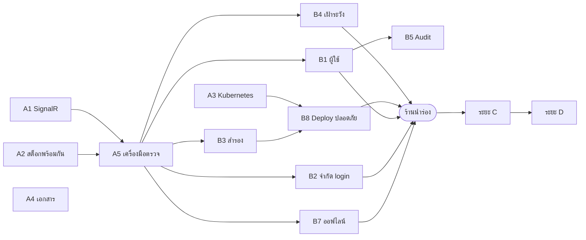

# 9. แผนปรับปรุงระบบ: ความสมบูรณ์ ประสิทธิภาพ และการรองรับปัญหา

แผนนี้ต่อยอดจากสิ่งที่พบใน [รายงานการวิเคราะห์](01-research-report.md) และลงรายละเอียดกว่า [แผนแม่บท](02-master-plan.md):
ระบุว่าแต่ละเรื่องจะแก้อย่างไรในโค้ด พิสูจน์ว่าเสร็จด้วยอะไร และทำลำดับไหน

การประมาณแรงงานเป็น "วันทำงานของนักพัฒนา 1 คนที่มี AI ช่วย" เป็นการประมาณคร่าว ๆ จากขนาดงาน ยังไม่ได้ยืนยันด้วยการทำจริง

## 1. ภาพรวมของแผน

| ระยะ | เป้าหมาย                               | ประมาณ   | ขึ้นกับการตัดสินใจของเจ้าของโครงการ |
| ---- | ------------------------------------- | -------- | ----------------------------- |
| A    | ปิดปัญหาที่พบใหม่ และสร้างเครื่องมือตรวจที่ยังขาด | 6–9 วัน   | ไม่                            |
| B    | รองรับปัญหาที่เกิดได้ในการใช้งานจริง          | 15–20 วัน | บางส่วน                        |
| C    | เติมฟีเจอร์ให้ครบวงจรการทำงานของร้าน       | 25–35 วัน | ใช่ (สูตรภาษี)                   |
| D    | รองรับร้านจำนวนมากและหลาย instance      | 20–30 วัน | ใช่ (ผู้ดูแลแพลตฟอร์ม)             |

ระยะ A เริ่มได้ทันทีโดยไม่ต้องรอใคร ระยะ B ทำขนานกับการรอคำตอบของระยะ C ได้

## 2. ระยะ A: ปิดปัญหาที่พบใหม่

### ความคืบหน้า (27 พฤศจิกายน 2026)

| งาน                     | สถานะ  | หลักฐาน                                                                                                                                        |
| ----------------------- | ------ | --------------------------------------------------------------------------------------------------------------------------------------------- |
| A1 SignalR              | เสร็จ   | Client ตรึงที่รุ่น 10, script `frontend/scripts/check-realtime.mjs` ต่อผ่าน WebSocket จริงและได้รับ event ครบ, test ในเบราว์เซอร์ยืนยันการอัปเดตข้ามหน้าต่าง    |
| A2 ขายพร้อมกัน            | เสร็จ   | Test บน PostgreSQL จริง: 12 เครื่องขายสินค้า 5 ชิ้นพร้อมกัน สำเร็จ 5 ถูกปฏิเสธ 7 สต็อกเหลือ 0 (ก่อนแก้: ขายได้ทั้ง 12) รวมถึงการแลกแต้มพร้อมกันและการส่งบิลเดียวกันซ้อนกัน |
| A3 Kubernetes           | เสร็จ   | ตั้ง 1 replica, ถอด autoscaler, เขียนเหตุผลในไฟล์ ยังไม่ได้ลองกับ cluster จริง                                                                          |
| A4 เอกสารและ SQL Server | เสร็จ   | เอกสารเก่า 5 ไฟล์เป็นลิงก์ไปเอกสารปัจจุบัน, ถอดตัวเลือก SQL Server ออกทั้งหมด                                                                             |
| A5 Test กับ PostgreSQL   | เสร็จ   | ชุด test ของ API รันซ้ำบน PostgreSQL ด้วย Testcontainers (รวม 112 ข้อ)                                                                             |
| A5 Smoke test           | เสร็จ   | `deploy/smoke-test.mjs` มีโหมดอ่านอย่างเดียวสำหรับ production และโหมดเต็ม 30 ข้อ                                                                     |
| A5 Test ในเบราว์เซอร์     | เสร็จ   | Playwright 6 ข้อผ่านกับ stack จริง: login, ขาย, ขายออฟไลน์แล้วส่งบิล, real-time, ภาษา/โหมดมืด/จอมือถือ                                                   |
| A5 การตรวจด้วยคน         | บางส่วน | ตรวจจากภาพหน้าจอของ Chromium แล้ว ยังไม่ได้ตรวจบนแท็บเล็ต มือถือ และเบราว์เซอร์อื่นจริง                                                                     |
| CI                      | เสร็จ   | ทุก job ผ่านบน GitHub ใน PR #7 รวม job ที่รัน stack, smoke test และ test ในเบราว์เซอร์                                                               |

สิ่งที่การตรวจในเบราว์เซอร์จริงพบและแก้แล้ว: ป้ายภาษีในตะกร้าแสดงเป็น `7.000000000000001%`, และไอคอนกระดิ่งแสดงอยู่แม้ server ปิด push
สิ่งที่พบและยังไม่ได้แก้: บนจอที่สูงน้อยกว่าประมาณ 750 px ปุ่ม "ล้างตะกร้า" ในหน้าขายอยู่ต่ำกว่าขอบจอ ต้องเลื่อนลงจึงจะเห็น

### A1. เวอร์ชันของ SignalR ไม่ตรงกัน (0.5 วัน)

- **ปัญหา:** frontend ใช้ `@microsoft/signalr` รุ่น 11 ส่วน server เป็น ASP.NET Core 10 และยังไม่เคยเชื่อมต่อกันจริง
- **วิธีแก้:** ตรึง client ไว้ที่สาย 10 ให้ตรงกับ server แล้วทดสอบการเชื่อมต่อจริงกับ stack ในเครื่อง
- **เสร็จเมื่อ:** เปิดสองเบราว์เซอร์ ขายจากเครื่องหนึ่ง แล้ว dashboard ของอีกเครื่องอัปเดตเองและมีแจ้งเตือนสินค้าใกล้หมด

### A2. การตัดสต็อกผิดเมื่อขายพร้อมกัน (2–3 วัน)

- **ปัญหา:** `OrderService` อ่านจำนวนคงเหลือ ลบออก แล้วบันทึก ถ้าสองคำขอทำพร้อมกัน ทั้งคู่อ่านค่าเดิม ผลคือสต็อกถูกตัดครั้งเดียวจากการขายสองครั้ง หรือขายเกินจำนวนที่มี
- **วิธีแก้:** ใช้ optimistic concurrency ของ EF Core กับ `InventoryItem` โดยใช้คอลัมน์ระบบ `xmin` ของ PostgreSQL เป็นตัวบอกเวอร์ชันของแถว
  เมื่อบันทึกชนกัน ให้โหลดสินค้าใหม่ ตรวจสต็อกอีกครั้ง แล้วลองใหม่ไม่เกิน 3 ครั้ง ถ้ายังชนให้ตอบ 409
- **ผลข้างเคียงที่ต้องจัดการ:** การแก้ไขสินค้าจากหน้า Inventory ขณะมีการขายจะชนได้เช่นกัน ต้องตอบ 409 พร้อมข้อความให้โหลดข้อมูลใหม่
- **เสร็จเมื่อ:** มี test ที่ยิงการขาย 20 รายการพร้อมกันกับสินค้าที่มี 10 ชิ้น แล้วได้ผลสำเร็จ 10 รายการ ถูกปฏิเสธ 10 รายการ และสต็อกเหลือ 0 พอดี
  test นี้ต้องรันกับ PostgreSQL จริง (ดู A5) เพราะฐานข้อมูลใน memory ไม่จำลองการชนกัน

### A3. ไฟล์ Kubernetes ที่ใช้ไม่ได้จริง (0.5 วัน)

- **ปัญหา:** `backend/k8s/deployment.yaml` ตั้ง 3 replica และมี autoscaler ทั้งที่ API ต้องรัน instance เดียว (คิว push และกลุ่มของ SignalR อยู่ใน memory, migration รันตอน start)
- **วิธีแก้:** ตั้ง replica เป็น 1 ถอด autoscaler ออก และเขียนหมายเหตุในไฟล์กับใน `backend/DEPLOYMENT.md` ว่าการรันหลาย instance รอระยะ D
- **เสร็จเมื่อ:** ไฟล์ไม่ทำให้เข้าใจว่าขยายแนวนอนได้

### A4. เอกสารและตัวเลือกที่ล้าสมัย (1–2 วัน)

- **ปัญหา:** `backend/ARCHITECTURE.md`, `DATABASE_SCHEMA.md`, `API_EXAMPLES.md`, `QUICKSTART.md` และ `IMPLEMENTATION_SUMMARY.md` ยังอธิบายระบบเดิม และตัวเลือก SQL Server ไม่มี migration
- **วิธีแก้:** แทนเนื้อหาของไฟล์เก่าด้วยลิงก์ไปยังเอกสารชุด `docs/project/` หรือลบทิ้ง, ถอดตัวเลือก SQL Server ออกจาก `Program.cs`, package และการตั้งค่า
- **เสร็จเมื่อ:** ค้นคำว่า `tenant/{tenantId}` ในเอกสารแล้วไม่พบ และ repo ไม่มีการตั้งค่าที่ใช้ไม่ได้

### A5. เครื่องมือตรวจที่ยังขาด (2–3 วัน)

ช่องว่างของหลักฐานที่ใหญ่ที่สุดคือระบบยังไม่เคยถูกตรวจในเบราว์เซอร์จริง และ test ไม่ได้รันกับฐานข้อมูลจริง

| เครื่องมือ                         | ใช้ทำอะไร                                                                                       | เสร็จเมื่อ                                       |
| ------------------------------- | ---------------------------------------------------------------------------------------------- | --------------------------------------------- |
| Testcontainers สำหรับ PostgreSQL | รัน integration test ของ backend กับ PostgreSQL จริงใน CI                                         | Test ของ A2 และ test ที่พึ่ง unique index รันใน CI |
| Smoke test ของ stack            | นำ script ที่ใช้ทดสอบ stack ในเครื่อง (27 ข้อ) เข้า repo และรันใน CI หลัง build image                   | Pipeline ล้มถ้า image ที่ build ใช้งานไม่ได้         |
| Playwright                      | End-to-end test ในเบราว์เซอร์จริง: login, ขาย, ขายออฟไลน์แล้วกลับมาออนไลน์, real-time ระหว่างสองหน้าต่าง | Flow หลัก 4 เรื่องผ่านใน CI                       |
| การตรวจด้วยคน                    | เปิดทุกหน้าจอบนคอมพิวเตอร์ แท็บเล็ต และมือถือจริง ทั้งโหมดสว่างและมืด                                        | มีรายการสิ่งที่พบและแก้แล้ว                          |

## 3. ระยะ B: รองรับปัญหาที่เกิดได้ในการใช้งานจริง

### 3.1 ปัญหาที่อาจเกิด และแผนรับมือ

ตารางนี้ไล่ตามสิ่งที่ผิดพลาดได้ ไม่ใช่ตามโมดูล

| สิ่งที่อาจเกิด                                                    | ตอนนี้ระบบทำอย่างไร                                         | แผน                                                                                      | งาน |
| ------------------------------------------------------------ | -------------------------------------------------------- | ---------------------------------------------------------------------------------------- | --- |
| เน็ตของร้านหลุดระหว่างขาย                                        | หน้า POS ขายต่อและเข้าคิว                                    | คงไว้                                                                                     | –   |
| เบราว์เซอร์ล้างข้อมูลของเว็บ ขณะมีบิลค้างในคิว                         | **บิลที่ยังไม่ส่งหายถาวร** โดยไม่มีใครรู้                          | ขอพื้นที่เก็บแบบถาวรจากเบราว์เซอร์, เตือนเมื่อมีบิลค้างนานเกินกำหนดและก่อนออกจากระบบ, ให้ส่งออกคิวเป็นไฟล์ได้ | B7  |
| บิลออฟไลน์ถูก server ปฏิเสธเพราะสต็อกไม่พอ                         | ค้างในคิวให้คนจัดการ ทั้งที่ขายไปแล้ว                             | รอการตัดสินใจ: ยอมให้สต็อกติดลบสำหรับบิลออฟไลน์ หรือคงแบบเดิมและเพิ่มหน้าจัดการ                        | B7  |
| ส่งบิลซ้ำจากการกดสองครั้งหรือการลองใหม่                             | `clientOrderId` กันไว้                                     | คงไว้                                                                                     | –   |
| ขายพร้อมกันสองเครื่อง                                            | สต็อกอาจผิด                                                | A2                                                                                       | A2  |
| ฐานข้อมูลล่ม                                                    | API ตอบ 500 แต่ `/health` ยังตอบว่าปกติ เพราะไม่ได้ตรวจฐานข้อมูล | แยก `/health` (ตัวแอปทำงาน) กับ `/health/ready` (ต่อฐานข้อมูลได้) และให้ระบบเฝ้าระวังเรียกตัวหลัง    | B4  |
| ระบบล่มตอนไม่มีคนดู                                              | ไม่มีใครรู้จนลูกค้าแจ้ง                                         | เฝ้าระวังจากภายนอกพร้อมแจ้งเตือน                                                              | B4  |
| ข้อมูลในฐานข้อมูลเสียหรือ server เสีย                               | ไม่มีข้อมูลสำรอง                                             | สำรองอัตโนมัติทุกวันเก็บนอก server และซ้อมกู้คืน                                                   | B3  |
| Deploy เวอร์ชันที่มีข้อบกพร่อง                                      | Rollback ได้โดยแก้ `IMAGE_TAG`                             | เพิ่ม smoke test หลัง deploy และเขียนขั้นตอน rollback ที่ซ้อมแล้ว                                  | B8  |
| Migration ทำข้อมูลเสีย หรือ rollback แล้วโค้ดเก่าใช้กับฐานข้อมูลใหม่ไม่ได้ | ไม่มีการป้องกัน                                              | สำรองก่อน migrate ทุกครั้ง และกำหนดกติกาว่า migration ต้องเข้ากันได้กับโค้ดหนึ่งเวอร์ชันก่อนหน้า           | B8  |
| มีคนเดารหัสผ่าน                                                 | ลองได้ไม่จำกัด                                              | จำกัดจำนวนครั้งต่อบัญชีและต่อ IP                                                                | B2  |
| พนักงานลาออก                                                  | ปิดบัญชีไม่ได้ เพราะไม่มีการจัดการผู้ใช้                            | จัดการผู้ใช้ และยกเลิก refresh token ทั้งหมดของบัญชีที่ถูกปิด                                         | B1  |
| ข้อมูลรั่วข้ามร้านจากโค้ดใหม่                                        | มี query filter และ test กำกับ entity ปัจจุบัน                | เพิ่ม test ที่ตรวจว่าทุก entity ของร้านมี query filter เพื่อจับ entity ใหม่ที่ลืมใส่                     | B6  |
| ไม่รู้ว่าใครแก้สต็อกหรือยกเลิกบิล                                     | ไม่มีบันทึก                                                  | Audit trail                                                                              | B5  |
| Push service ล่มหรือช้า                                         | การขายไม่รอ, แจ้งเตือนในคิวอาจหายถ้า API restart              | ยอมรับได้สำหรับการแจ้งเตือน ถ้ามีงานสำคัญกว่าใช้คิวนี้ให้ย้ายไปคิวที่เก็บถาวร (ระยะ D)                      | –   |
| ตาราง refresh token โตไม่หยุด                                  | ไม่มีการลบ                                                 | งานเบื้องหลังลบ token ที่หมดอายุทุกวัน                                                           | B1  |

### 3.2 งานของระยะ B

#### ความคืบหน้า (27 พฤศจิกายน 2026)

| งาน                   | สถานะ  | หลักฐาน และสิ่งที่ยังเหลือ                                                                                                                                                                                                                                                          |
| --------------------- | ------ | ---------------------------------------------------------------------------------------------------------------------------------------------------------------------------------------------------------------------------------------------------------------------------- |
| B1 จัดการผู้ใช้           | เสร็จ   | Endpoint `/api/users` และ `/api/auth/change-password`, หน้า "ผู้ใช้งาน" และปุ่มเปลี่ยนรหัสผ่านที่แถบบน, งานลบ token ที่หมดอายุ Test ของ API 16 ข้อ (รันทั้งบน in-memory และ PostgreSQL), test หน้าจอ 7 ข้อ, smoke test 5 ข้อ และ test ในเบราว์เซอร์จริง 1 เส้นทาง (เพิ่มแคชเชียร์ → เปลี่ยนรหัสผ่าน → ถูกปิดบัญชี) |
| B2 ป้องกันการเดารหัสผ่าน  | เสร็จ   | ล็อกบัญชี 15 นาทีหลังผิด 5 ครั้ง และจำกัด 60 ครั้งต่อนาทีต่อ IP มี test ทั้งสองแบบ ตัวนับอยู่ใน memory จึงใช้ได้กับ API instance เดียว ยังไม่ได้ทดสอบหลัง reverse proxy HTTPS จริงว่าอ่าน IP ผู้ใช้ถูก                                                                                                            |
| B4 เฝ้าระวัง            | บางส่วน | มี `/health/ready` (ตอบ 503 เมื่อฐานข้อมูลล่ม มี test), log ไม่ออกซ้ำแล้ว และมีรหัสอ้างอิงของ request ใน log ยังไม่ได้ทำ: บริการตรวจจากภายนอกพร้อมแจ้งเตือน และการส่ง log ไปที่เก็บกลาง ซึ่งต้องเลือกบริการก่อน                                                                                             |
| B6 ตัวป้องกันการรั่วข้ามร้าน | เสร็จ   | Test ไล่ทุก entity ของร้านแล้วยืนยันว่ามี query filter ลองถอด filter ออกแล้ว test ล้มจริง                                                                                                                                                                                               |
| B3 สำรองและกู้คืน        | เสร็จ   | สำรองตามเวลาและก่อน deploy, ซ้อมกู้คืนใน CI, และส่งสำเนาไปที่เก็บแบบ S3 นอก server เมื่อตั้ง `BACKUP_S3_BUCKET` ในตัวแปรของ stack คงเหลือ: ลองกับผู้ให้บริการจริง, วัดเวลากู้คืนกับข้อมูลขนาดจริง, เข้ารหัสไฟล์ก่อนส่ง                                                                                         |
| B5 Audit trail        | เสร็จ   | บันทึกผู้ทำ เวลา และค่าก่อนหลังของการแก้สินค้า ลูกค้าและแต้ม การยกเลิกบิล และการจัดการผู้ใช้ มีหน้า "ประวัติการแก้ไข" Test ของ API 16 ข้อ (in-memory และ PostgreSQL), test หน้าจอ 3 ข้อ, smoke test 1 ข้อ และ test ในเบราว์เซอร์ 1 เส้นทาง ยังไม่มี: การลบประวัติเก่า และการแสดงชื่อผู้ขายบนบิล                        |
| B8 Deploy ที่ปลอดภัย     | เสร็จ   | Workflow รัน smoke test กับ production หลัง deploy (เมื่อตั้ง `SMOKE_URL`), สำรองก่อน migrate อัตโนมัติ, เอกสารกติกา migration และขั้นตอน rollback ใน `deploy/README.md` ซ้อมบน stack ในเครื่อง: อัปเกรด → rollback → กู้คืน → อัปเกรดอีกครั้ง ผ่านทุกขั้น ยังไม่ได้ซ้อมผ่าน Portainer จริง                     |
| B7 ความทนทานของออฟไลน์ | บางส่วน | เสร็จ: ขอพื้นที่เก็บถาวรจากเบราว์เซอร์และเตือนเมื่อเบราว์เซอร์ไม่รับรอง, แสดงเวลาที่ sync รายการสินค้าล่าสุด, เตือนก่อนออกจากระบบและเมื่อบิลค้างเกิน 24 ชั่วโมง, ส่งออกคิวเป็นไฟล์ `.csv` คงเหลือ: การตัดสินใจข้อ 2 (สต็อกติดลบ) และข้อ 3 (PIN ของเครื่อง) ในหัวข้อ 6, การนำไฟล์ที่ส่งออกกลับเข้าคิว, ทดสอบบนอุปกรณ์จริง            |

| งาน                       | รายละเอียด                                                                                                                                                                                          | เสร็จเมื่อ                                                                 | ประมาณ |
| ------------------------- | -------------------------------------------------------------------------------------------------------------------------------------------------------------------------------------------------- | ----------------------------------------------------------------------- | ------ |
| **B1 จัดการผู้ใช้**           | Endpoint และหน้าจอให้ Owner/Admin เพิ่ม ปิดการใช้งาน และกำหนดบทบาทของผู้ใช้ในร้าน, ผู้ใช้เปลี่ยนรหัสผ่านเอง, การปิดบัญชีหรือเปลี่ยนรหัสผ่านยกเลิก refresh token ทั้งหมดของบัญชีนั้น, ป้องกันการลบ Owner คนสุดท้าย, งานลบ token ที่หมดอายุ | Test: ผู้ใช้ที่ถูกปิด refresh ไม่ได้อีก, Cashier จัดการผู้ใช้ไม่ได้, ร้านอื่นมองไม่เห็นผู้ใช้   | 4–5 วัน |
| **B2 ป้องกันการเดารหัสผ่าน**  | Rate limiting ของ ASP.NET Core ที่ `/api/auth/login` และ `/refresh` ต่อ IP และล็อกบัญชีชั่วคราวหลังผิดหลายครั้ง, หลัง reverse proxy ต้องอ่าน IP จริงจาก header ที่ไว้ใจได้                                             | Test: ผิดเกินกำหนดได้ 429, รหัสถูกหลังพ้นเวลาล็อกเข้าได้                          | 1–2 วัน |
| **B3 สำรองและกู้คืน**        | Container ที่รัน `pg_dump` ตามเวลาและส่งไปเก็บนอก server, กำหนดระยะเวลาเก็บ, เอกสารขั้นตอนกู้คืน                                                                                                              | ซ้อมกู้คืนลงฐานข้อมูลเปล่าสำเร็จ และบันทึกเวลาที่ใช้                                 | 2 วัน   |
| **B4 เฝ้าระวัง**            | `/health/ready` ที่ตรวจฐานข้อมูล, บริการตรวจจากภายนอกพร้อมแจ้งเตือน, ส่ง log ไปที่เก็บกลาง, แก้ log ที่ออกซ้ำ, ใส่รหัสอ้างอิงของ request ใน log และในข้อความ error                                                      | ปิด container ของฐานข้อมูลแล้วได้รับแจ้งเตือนภายในเวลาที่กำหนด                    | 2–3 วัน |
| **B5 Audit trail**        | บันทึกผู้ทำ เวลา และค่าก่อนหลัง สำหรับการแก้สต็อก ยกเลิกบิล เปลี่ยนแต้ม และจัดการผู้ใช้ โดยเก็บผ่านการบันทึกของ `ApplicationDbContext`                                                                                    | Test: แก้สต็อกแล้วมีบันทึกที่ระบุผู้ทำถูกต้อง และร้านอื่นอ่านไม่ได้                        | 2–3 วัน |
| **B6 ตัวป้องกันการรั่วข้ามร้าน** | Test ที่ไล่ทุก entity ซึ่งสืบทอดจาก `TenantEntity` แล้วยืนยันว่ามี query filter                                                                                                                                | เพิ่ม entity ใหม่โดยไม่ใส่ filter แล้ว test ล้ม                                | 0.5 วัน |
| **B7 ความทนทานของออฟไลน์** | ขอพื้นที่เก็บถาวร (`navigator.storage.persist`), แสดงเวลาที่ sync รายการสินค้าล่าสุด, เตือนเมื่อมีบิลค้างในคิวก่อนออกจากระบบ, ส่งออกคิวเป็นไฟล์, ดำเนินการตามผลการตัดสินใจเรื่องสต็อกติดลบ                                       | Test ของการเตือนและการส่งออก และทดสอบบนอุปกรณ์จริงว่าคิวไม่หายหลังปิดเปิดเบราว์เซอร์ | 2–3 วัน |
| **B8 Deploy ที่ปลอดภัย**     | รัน smoke test กับ production หลัง deploy, สำรองฐานข้อมูลก่อน migrate, เอกสารกติกา migration และขั้นตอน rollback                                                                                            | ซ้อม rollback บน stack ทดสอบสำเร็จ                                        | 1–2 วัน |

## 4. ระยะ C: ความสมบูรณ์ของฟีเจอร์

เรียงตามผลต่อการใช้งานประจำวันเทียบกับแรงที่ใช้ รายการที่ API มีอยู่แล้วมาก่อน

| ลำดับ | งาน                            | สิ่งที่ต้องทำ                                                                                                                                                                                                                                                                                                                  | ขึ้นกับ                         | ประมาณ |
| ---- | ------------------------------ | ------------------------------------------------------------------------------------------------------------------------------------------------------------------------------------------------------------------------------------------------------------------------------------------------------------------------- | ---------------------------- | ------ |
| C1   | ประวัติบิลและการยกเลิก             | **เสร็จแล้ว:** หน้า "ประวัติการขาย" กรองตามช่วงวันและสถานะ ดูรายละเอียด ยกเลิก ส่งออก CSV แบ่งหน้าที่เบราว์เซอร์จนกว่า C3 จะเสร็จ                                                                                                                                                                                                            | –                            | 2–3 วัน |
| C2   | แก้ไขลูกค้า และหน้าจอ subscription | **เสร็จแล้ว:** แก้ไขลูกค้า (ชื่อ อีเมล เบอร์โทร ที่อยู่) และหน้า "แพ็กเกจของร้าน" แบบอ่านอย่างเดียว ปุ่มต่ออายุรอการตัดสินใจเรื่องการชำระเงิน                                                                                                                                                                                                         | –                            | 1–2 วัน |
| C3   | แบ่งหน้าที่ server                 | **เสร็จแล้ว:** `page`, `pageSize`, `sort` และจำนวนรวมสำหรับสินค้า ลูกค้า และบิล หน้าจอทั้งสามแบ่งหน้าและเรียงที่ server คำตอบแบบเดิม (ไม่ส่ง `page`) ยังอยู่เพื่อแอปรุ่นก่อน และต้องถอดออกในรุ่นถัดไป                                                                                                                                                    | เปลี่ยนสัญญา API                | 3–4 วัน |
| C4   | ส่วนลดในหน้า POS                 | **เสร็จแล้ว:** ส่วนลดรายสินค้า (บาท) และท้ายบิล (บาทหรือ %) หักก่อนภาษี คงเหลือ: การจำกัดว่าใครให้ส่วนลดได้และได้เท่าไร (ตอนนี้ทุกคนที่ขายได้ให้ส่วนลดได้)                                                                                                                                                                                            | **สูตรภาษี**                   | 3–4 วัน |
| C5   | ใบเสร็จ                         | **บางส่วน:** พิมพ์ใบเสร็จรับเงินจากเบราว์เซอร์ (บันทึกเป็น PDF ได้) หลังขายและจากประวัติการขาย พร้อมชื่อพนักงานขาย คงเหลือ: PDF ที่ server, ใบกำกับภาษีอย่างย่อ (รอการตัดสินใจและการอนุมัติของกรมสรรพากร)                                                                                                                                                | สูตรภาษี, ข้อมูลร้านสำหรับหัวใบเสร็จ | 4–5 วัน |
| C6   | แต้มสะสมอัตโนมัติ                  | **เสร็จแล้ว:** ร้านตั้งอัตราแต้มเอง ได้แต้มจากยอดที่จ่ายจริง หักคืนเมื่อยกเลิกบิล และใช้แต้มเป็นส่วนลดที่หน้าขายได้ (หักก่อน VAT, เฉพาะตอนออนไลน์, คืนแต้มเมื่อยกเลิกบิล) คงเหลือ: วันหมดอายุของแต้ม, ขั้นต่ำของการใช้แต้ม, และให้ผู้ทำบัญชียืนยันการคิด VAT ของส่วนลดจากแต้ม                                                                                                    | กติกาแต้มของร้าน                | 2 วัน   |
| C7   | รายงานและ `.xlsx`              | **เสร็จแล้ว:** หน้า "รายงาน" แสดงยอดขายตามวัน (พร้อมกราฟ) สินค้า หมวดหมู่ พนักงาน และวิธีชำระเงิน รวมยอดในฐานข้อมูล ดาวน์โหลดเป็น `.xlsx` ที่สร้างที่ server ได้ และมีต้นทุนกับกำไรขั้นต้นจากต้นทุนที่เก็บไว้กับบิล ณ เวลาที่ขาย คงเหลือ: รายงานสต็อก, กำไรของบิลที่ขายก่อนเริ่มเก็บต้นทุน (ไม่มีข้อมูลให้คำนวณ), และย้าย dashboard มาใช้ query ชุดเดียวกัน (D2)                       | C3                           | 5–6 วัน |
| C8   | รูปสินค้าและการนำเข้า              | **เสร็จแล้ว:** นำเข้าสินค้าจากไฟล์ `.xlsx` หรือ `.csv` (ตรวจก่อนบันทึก รายงานแถวที่ผิด บันทึกทั้งไฟล์หรือไม่บันทึกเลย) และรูปสินค้าที่เก็บบนดิสก์ของ server ย่อก่อนส่ง แสดงในรายการสินค้าและหน้าขาย คัดลอกไปนอก server พร้อมไฟล์สำรองเมื่อตั้งปลายทาง ลบไฟล์รูปเมื่อลบสินค้า และเก็บรูปที่เคยแสดงไว้ใช้ตอนออฟไลน์ คงเหลือ: ย้ายที่เก็บรูปไป S3 ถ้าต้องการ, ปิดการขายสินค้าจากไฟล์, ไฟล์ `.xls` | ที่เก็บไฟล์                      | 4–5 วัน |
| C9   | ข้อความ error ตามภาษาของผู้ใช้     | **เสร็จแล้ว:** error ที่ผู้ใช้ต้องอ่านมี `code` และ `params` คงที่ (28 รหัส) และหน้าจอแสดงประโยคตามภาษาของผู้ใช้ มี test ที่ล้มเมื่อรหัสใหม่ไม่มีคำแปล คงเหลือ: error ของการตรวจรูปแบบข้อมูลรายช่องจาก server ยังเป็นภาษาอังกฤษ (หน้าจอตรวจเองก่อนส่งอยู่แล้ว)                                                                                                     | –                            | 2 วัน   |

รายการ C1, C2 และ C9 ไม่ขึ้นกับการตัดสินใจใด จึงทำก่อนได้ระหว่างรอคำตอบเรื่องสูตรภาษี

## 5. ระยะ D: ประสิทธิภาพและการขยายขนาด

ยังไม่ควรเริ่มจนกว่าจะมีร้านใช้งานจริงและมีตัวเลขให้ตัดสินใจ

| งาน                 | สิ่งที่ต้องทำ                                                                                       | เสร็จเมื่อ                                                          |
| ------------------- | ---------------------------------------------------------------------------------------------- | ---------------------------------------------------------------- |
| D1 วัดก่อนแก้          | Load test กับ flow การขายและ dashboard เพื่อหาขีดจำกัดจริงและจุดที่ช้า                                   | มีตัวเลขของเวลาตอบสนองและจำนวนการขายต่อวินาทีที่รับได้                    |
| D2 รายงานในฐานข้อมูล  | ย้ายการรวมยอดของ dashboard จาก memory ไปเป็น query ที่รวมในฐานข้อมูล และเพิ่ม index ตามผลของ D1        | Dashboard ของร้านที่มีบิลหลักแสนตอบในเวลาที่กำหนดจาก D1                  |
| D3 หลาย instance    | Redis เป็น backplane ของ SignalR, คิวงานที่เก็บถาวรแทนคิวใน memory, migration เป็นขั้นตอนแยกใน pipeline | รัน API 2 instance แล้ว event ถึงผู้ใช้ทุกคน และ deploy โดยไม่มี downtime |
| D4 Observability    | OpenTelemetry สำหรับ metrics และ tracing                                                        | ไล่ request ที่ช้าได้จาก frontend ถึง query                            |
| D5 แพลตฟอร์ม SaaS    | ผู้ดูแลแพลตฟอร์ม, สมัครใช้งานเอง, login ด้วยชื่อร้าน, บังคับใช้ subscription                                | ร้านใหม่เริ่มใช้ได้โดยไม่ต้องมีคนตั้งค่าให้                                   |
| D6 ขนาดของ frontend | แยก chunk ของ library กราฟและตรวจขนาด bundle ใน CI                                             | JS ก้อนหลักต่ำกว่าเส้นที่กำหนด                                          |

## 6. การตัดสินใจที่ต้องการจากเจ้าของโครงการ

| #   | คำถาม                                    | ทางเลือก                                                                       | ข้อเสนอ                                                       | งานที่รอ |
| --- | ---------------------------------------- | ----------------------------------------------------------------------------- | ------------------------------------------------------------ | ------ |
| 1   | ภาษีคิดอย่างไร                              | ก) คิดจากยอดหลังหักส่วนลด ข) คิดจากยอดก่อนหักส่วนลด (ปัจจุบัน) และราคาสินค้ารวมภาษีแล้วหรือยัง | ต้องให้ผู้รู้ด้านบัญชีของธุรกิจยืนยัน                                     | C4, C5 |
| 2   | บิลออฟไลน์ที่สต็อกไม่พอ                        | ก) รับบิลและยอมให้สต็อกติดลบ ข) ปฏิเสธและให้คนจัดการ (ปัจจุบัน)                          | ก) เพราะการขายเกิดขึ้นจริงแล้ว และสต็อกติดลบบอกเจ้าของร้านว่าต้องตรวจนับ | B7     |
| 3   | เปิดแอปตอนออฟไลน์โดยไม่ถามรหัสผ่าน            | ก) คงไว้ ข) ต้องใส่ PIN ของเครื่อง ค) บังคับ login ใหม่                               | ข) สำหรับเครื่องที่ใช้ร่วมกัน                                        | B7     |
| 4   | ข้อมูลสำรองเสียได้มากสุดกี่ชั่วโมง และเก็บนานเท่าไร | –                                                                             | สำรองทุกวันเป็นอย่างน้อย และเพิ่มความถี่ถ้ายอมเสียข้อมูลหนึ่งวันไม่ได้         | B3     |
| 5   | ใครเป็นผู้ดูแลแพลตฟอร์ม                       | –                                                                             | –                                                            | D5     |
| 6   | ใครให้ส่วนลดได้ และให้ได้เท่าไร                | –                                                                             | –                                                            | C4     |

## 7. ลำดับที่แนะนำ

1. **สัปดาห์ที่ 1–2:** ระยะ A ทั้งหมด โดยเริ่มจาก A5 ส่วน Testcontainers ก่อน เพราะ A2 ต้องใช้
2. **สัปดาห์ที่ 3–5:** B1, B2, B3, B4, B8 ซึ่งเป็นเงื่อนไขของการเปิดให้ร้านนำร่องใช้ และ B6 ซึ่งเล็กมาก
3. **ระหว่างนั้น:** ขอคำตอบของหัวข้อ 6 ข้อ 1–4
4. **ก่อนร้านนำร่อง:** B7 และ B5
5. **หลังร้านนำร่องเริ่มใช้:** ระยะ C โดยเริ่มจาก C1, C2, C9 และปรับลำดับที่เหลือตามความเห็นของร้าน
6. **เมื่อมีตัวเลขการใช้งานจริง:** ระยะ D โดยเริ่มจาก D1

## 8. นิยามของ "เสร็จ" สำหรับทุกงานในแผนนี้

- มี test ที่พิสูจน์เกณฑ์ "เสร็จเมื่อ" และผ่านใน CI
- งานที่แตะฐานข้อมูลหรือการทำงานพร้อมกัน มี test ที่รันกับ PostgreSQL จริง
- งานที่แตะหน้าจอ ถูกเปิดดูในเบราว์เซอร์จริง
- [docs/API_REFERENCE.md](../API_REFERENCE.md) และเอกสารในชุดนี้อัปเดตตาม
- รายงานระบุสิ่งที่ยังไม่ได้ยืนยัน
